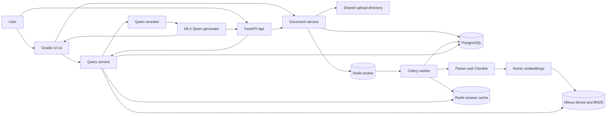

# Architecture and implementation guide

This document describes the files and behavior on the `testing` branch. The
implementation, [requirements.txt](requirements.txt), and
[app/core/config.py](app/core/config.py) are the authoritative sources when
they change.

## 1. System overview

There are separate web, worker, PostgreSQL, Redis, and Milvus processes.
Redis serves two roles: Celery broker and answer cache. PostgreSQL stores the
registry and current chunks, the upload directory stores original bytes, and
Milvus stores search records and vectors. None is a complete backup of the
others. The UI calls services in-process rather than making HTTP calls to the
API. FastAPI and the worker share infrastructure and configuration, not
Python memory.

## 2. Technology and dependencies

| Area | Used technology | Purpose |
| --- | --- | --- |
| Web/UI | FastAPI, Uvicorn, Gradio, Pydantic, `python-multipart` | HTTP endpoints, validation, file uploads, and UI |
| Jobs | Celery with Redis | Background document processing |
| Configuration | `pydantic-settings`, `python-dotenv` | Environment and `.env.local` settings |
| Metadata | PostgreSQL, psycopg, psycopg-pool | Document/version registry, chunks, locking |
| Search | Milvus Lite or server, pymilvus | Dense cosine and sparse BM25 search with RRF |
| Extraction | PDFOxide, pdfplumber, pypdfium2, Tesseract, python-docx, python-pptx, openpyxl, Beautiful Soup | Format-specific content and OCR |
| Chunking | Chonkie | Recursive text and row-based table chunks |
| Embeddings/reranking | Sentence Transformers, Transformers, PyTorch, NumPy | Nomic vectors and Qwen relevance scoring |
| Generation | MLX, mlx-lm | Local language-model generation on Apple Silicon |
| Models | Hugging Face Hub | Model and tokenizer retrieval/cache |

Pillow supports image processing, and Redis and Celery use their corresponding
client packages. `pgvector` is listed as a dependency but the current schema
and retrieval path use Milvus, not PostgreSQL vector search. See
[requirements.txt](requirements.txt) for exact dependency constraints;
there is no lockfile. Tesseract, PostgreSQL, and Redis are external services
or executables, not installed by that file.

## 3. Startup and process lifecycle

1. Follow [README setup](README.md#setup-and-run): create the database and
   environment, then start PostgreSQL, Redis, a shared Milvus server, the
   Celery worker, and Uvicorn. Configure all processes consistently and provide
   the worker access to the same upload paths.
2. [app/main.py](app/main.py) configures logging, creates or updates the basic
   PostgreSQL schema, and loads the MLX model in a background thread before
   serving requests. On shutdown it closes the PostgreSQL connection pool.
3. FastAPI mounts the document and query routers under `/api`, exposes
   `/health`, and mounts Gradio at `/ui`. `/health` does not test dependencies.
4. The worker consumes `CELERY_QUEUE` from Redis. Its task is late-acknowledged,
   rejects on worker loss, prefetches one task, and ignores results. Status is
   recorded in PostgreSQL rather than a Celery result backend.
5. Milvus client/collection and embedding model initialization are lazy;
   the reranker is also loaded on first use. Models are cached per process.

## 4. Document ingestion: start to finish

1. **Receive:** `POST /api/documents/upload` accepts multipart `files` and
   `acl_roles`; the Gradio Upload tab invokes the same document service.
   Files are handled sequentially within a request. The API reads each file
   into memory before validating it; an error on a later file does not undo
   earlier files.
2. **Validate and register:** [app/services/document_service.py](app/services/document_service.py)
   strips path components, checks extension, nonempty content and byte size,
   computes SHA-256, normalizes roles, and generates a UUID-prefixed safe
   storage name. [app/db/repository.py](app/db/repository.py) identifies
   documents by filename and serializes registration with a PostgreSQL
   advisory lock and row lock.
3. **Choose version:** a new filename creates version 1 (`new`); changed bytes
   create `updated`, increment the current version and mark old versions
   `superseded`; unchanged bytes refresh metadata/roles and return `unchanged`
   for pending, processing or processed versions. Other states are retried as
   `retry`. A retry restores missing stored bytes if necessary. New/updated
   bytes are saved under `UPLOAD_DIR`. Registration, file write, and queueing
   are separate operations, not one distributed transaction.
4. **Queue:** new, updated, and retry versions submit
   `rag.process_version` to Celery; unchanged versions are not queued. Queue
   errors are logged, recorded as failed when still pending, and propagated.
   The UI reports errors per file. A local-file Milvus URI is rejected for
   the worker; use a shared server.
5. **Claim and serialize:** [app/processing/pipeline.py](app/processing/pipeline.py)
   obtains a per-filename processing advisory lock, reloads the version, and
   claims a current nonprocessed version as `processing`. Stale or already
   processed tasks are skipped. Before writing, a second filename lock and
   version/status check prevent an older version from replacing a newer one.
6. **Parse:** [app/processing/parser.py](app/processing/parser.py) produces
   ordered `Block` objects with text/table content and optional headings,
   page or slide numbers, and table captions:

   | Input | Extracted content |
   | --- | --- |
   | PDF | PDFOxide native page text and heading hints; pdfplumber tables; pypdfium2 rendering and optional Tesseract OCR for image-bearing pages. Rotated table extraction may use a corrected page. |
   | DOCX | Paragraphs, headings, tables including nested content, headers/footers, and optional embedded-image OCR. |
   | PPTX | Slide text, titles, tables, chart data, notes, grouped shapes, and optional picture OCR. Slide numbers are recorded as pages. |
   | XLSX | Sheet cell values and formulas, including cached formula values when present, as tables; optional embedded-image OCR. Chart layout and labels are not extracted. |
   | HTML | Text, headings, tables/captions, image alt text, and optional OCR for base64 embedded images. Scripts/styles are removed; external images are not fetched. |
   | CSV | UTF-8-sig rows converted to a Markdown table. |
   | TXT/Markdown | UTF-8 text with replacement for decoding errors; Markdown remains source text. |

   OCR calls the external `tesseract` executable with the configured language;
   missing executable or failed OCR raises an error. PDF native text, tables,
   and OCR can overlap. Extraction of complex layouts, formulas, reading
   order, charts, and headings is not guaranteed.
7. **Chunk:** [app/processing/chunker.py](app/processing/chunker.py) applies
   Chonkie's recursive tokenizer-based text chunking and row-based Markdown
   table chunking, preserving block order. IDs are deterministic UUIDv5 values
   derived from document ID, kind, text hash, and duplicate occurrence.
   Metadata includes document, filename, version, hash, chunk type, block and
   part indices, headings, pages, caption, and measurement unit.
8. **Embed:** [app/embedding/embedder.py](app/embedding/embedder.py) prefixes
   text with `search_document:`, tokenizes without truncation, and rejects
   overlong inputs. It produces normalized vectors, checks dimensions and
   finite values, and uses MPS when available, otherwise CPU. An inference
   lock serializes embedding calls within each process.
9. **Persist:** the worker upserts stable IDs and vectors into Milvus in
   batches, removes stale vectors for the document, then replaces PostgreSQL
   chunks and marks the version `processed`. The PostgreSQL chunk replacement
   is transactional, but Milvus and PostgreSQL are not a single atomic
   transaction. Errors are logged, the processing version is marked `failed`,
   and the task raises. A superseded version is not made current again.
10. **Invalidate:** after successful persistence, the worker scans and deletes
    answer-cache keys and publishes a `documents_changed` event on
    `rag:events`. Redis failures are logged and do not undo ingestion.
    Stage durations are logged for parse, chunk, embed, vector writes/deletes,
    PostgreSQL persistence, and invalidation.

Version status normally moves `pending` -> `processing` -> `processed` or
`failed`; a newer upload can mark an older version `superseded`. Only the
current `processed` version is eligible for query retrieval.

## 5. Query and answer: start to finish

1. **Validate:** `POST /api/query` accepts a question of 1-2,000 characters,
   at most 20 roles, and `use_cache` (default true). Roles are stripped,
   case-folded to lowercase, deduplicated and sorted; empty roles become
   `public`. The normalized query uses Unicode NFKC, collapsed whitespace,
   casefolding, and stripped trailing `?`, `!`, `.`, and spaces; it is used
   for retrieval, not as the exact-cache key.
2. **Check cache:** the exact cache key hashes the original question after
   outer whitespace is stripped. A hit is accepted only if all stored sources
   are still current, processed, and intersect the requested roles. No
   semantic answer reuse is implemented. Cached answers with no sources are
   not accepted. The key namespace includes the collection and a hash of
   selected model/retrieval settings, not every setting.
3. **Embed and authorize:** on a miss, the normalized query is embedded with
   `search_query:`. PostgreSQL returns IDs of current processed documents whose
   role arrays overlap the supplied roles.
4. **Retrieve:** Milvus searches only those IDs with cosine dense vectors and
   BM25 sparse vectors, each using `RETRIEVAL_TOP_K` candidates. Reciprocal
   Rank Fusion (`RRF_K`) returns up to the same limit. New collections index
   headings plus text for BM25 while retaining original text; legacy sparse
   collections without `search_text` continue using their existing index.
5. **Rerank:** Qwen3-Reranker scores heading-enriched hits as the probability
   of `yes` versus `no`, sorts them, keeps up to `RERANK_TOP_N`, and applies
   `RERANK_MIN_SCORE`. Scores must be finite and between 0 and 1. If no
   hits survive, return the fixed no-content apology with no sources.
6. **Build context:** passages are numbered in rerank order, labeled with
   filename, headings, page/slide numbers and table type, and assembled to
   `CONTEXT_MAX_TOKENS` using the generator tokenizer. If the first passage
   alone is too large it is shortened; otherwise assembly stops before an
   overflowing passage. The returned sources are the passages actually used.
7. **Generate:** the MLX chat template receives a system instruction to use
   only context, cite sources, ignore document instructions, and begin with
   `<ANSWER>` or return `<NO_ANSWER>`. Thinking-tag content is filtered from
   streaming output. A no-answer, missing, or invalid marker yields the fixed
   apology and no sources. A generation reaching its token limit is marked
   potentially incomplete. An empty answer after `<ANSWER>` raises an error.
8. **Cite and respond:** numbered `[n]` or `[n, m]` references are linked to
   source metadata. An out-of-range number raises an error; citations are not
   independently verified for factual support. A successful answer and
   sources are cached if enabled. `timings_ms` reports applicable stages and
   total time. The UI streams fragments and final time; the synchronous HTTP
   endpoint consumes the stream and returns a single JSON response.

The relevance threshold and prompt are heuristics, not security controls.
Documents can contain adversarial instructions and generated answers can be
incorrect or cite unsupported passages.

## 6. Persistence, consistency, and access

- **PostgreSQL:** `documents` has one unique filename, current hash/version,
  metadata, timestamps and role array. `document_versions` records version
  ID, SHA-256, stored path, status, error, chunk count and timestamps.
  `document_chunks` holds current stored chunk text, type, index, token/row
  count and JSON metadata. Foreign keys and a document chunk index are
  created by [app/db/session.py](app/db/session.py); its pool has 1-10
  connections. Startup uses `CREATE TABLE IF NOT EXISTS` and an `ALTER` for
  roles, not a general migration system.
- **Milvus:** `chunk_id` is the primary key. Records contain dense vector,
  generated sparse vector, document and version identifiers, filename, hash,
  chunk type/index, text, search text and JSON metadata. Dense indexing uses
  cosine `AUTOINDEX`; sparse indexing uses BM25 `SPARSE_INVERTED_INDEX`.
  Text and heading-enriched search text are each limited to 65,535 UTF-8
  bytes; oversized chunks fail. Model and collection dimensions are checked,
  but matching dimensions do not prove that embedding models are compatible.
- **Redis:** answer entries expire after `CACHE_TTL_SECONDS`. Successful
  processing attempts whole-cache invalidation and publishes an event; no
  subscriber is implemented in this repository. Cache reads and writes log
  Redis errors and continue without caching. Source validation detects
  changed, inaccessible or unprocessed referenced documents, but cannot
  detect a newly added document that should change an old answer if
  invalidation failed. Namespace hashing omits some configuration, so clear
  cache or wait for expiry when changing other answer-affecting settings.
- **Filesystem:** uploads persist under `UPLOAD_DIR`, with paths stored in
  PostgreSQL. All workers must see those paths. Milvus Lite server data is
  separate; back up PostgreSQL, files, and Milvus consistently.
- **Access is not authentication:** query filtering relies on caller-supplied
  roles. Uploads can set roles, and document listing/chunk routes do not
  enforce roles. There is no user identity or authentication mechanism in
  this repository. Do not expose it to untrusted callers as-is.

## 7. Configuration reference

Settings come from uppercase environment variables and the repository-root
`.env.local`; environment variables override the file. The `Settings` object is
cached per process, so restart the web and worker processes after changes.
The example file covers only a subset. Defaults below are from code; paths are
relative to the repository root unless made absolute.

| Variable | Default | Purpose |
| --- | --- | --- |
| `DATABASE_URL` | `postgresql://apple@localhost:5432/rag` | PostgreSQL connection; replace the machine-specific user. |
| `MILVUS_URI` | `http://127.0.0.1:19530` | Shared Milvus server URL. Local file paths are supported by the client but rejected for queued ingestion. |
| `MILVUS_COLLECTION` | `document_chunks` | Search collection. |
| `REDIS_URL` | `redis://localhost:6379/0` | Celery broker and answer cache. |
| `CELERY_QUEUE` | `rag_ingestion` | Default ingestion task queue. |
| `EMBEDDING_MODEL` | `nomic-ai/nomic-embed-text-v1.5` | Sentence Transformer used for both indexing and querying. |
| `EMBEDDING_DIM` | `768` | Expected model and collection vector dimension. |
| `EMBEDDING_BATCH_SIZE` | `8` | Embedding batch size; lower it for memory pressure. |
| `EMBEDDING_MAX_SEQ_LENGTH` | `8192` | Maximum embedding input tokens including the task prefix; longer inputs fail. |
| `RERANKER_MODEL` | `Qwen/Qwen3-Reranker-0.6B` | Relevance model. |
| `LLM_MODEL` | `mlx-community/Qwen2.5-3B-Instruct-4bit` | MLX generator model. |
| `CHUNK_TOKENIZER` | `BAAI/bge-m3` | Chonkie text tokenizer, separate from the embedding model. |
| `CHUNK_TEXT_TOKENS` | `1024` | Text chunk size. |
| `CHUNK_TABLE_ROWS` | `12` | Table chunk size in rows. |
| `PDF_DO_OCR` | `true` | Enables OCR for image-bearing PDFs and supported embedded Office/HTML images, despite the PDF-specific name. |
| `OCR_LANGUAGE` | `eng` | Tesseract language code; corresponding language data must be installed. |
| `CACHE_TTL_SECONDS` | `86400` | Exact answer cache expiry. |
| `RETRIEVAL_TOP_K` | `15` | Candidate count per retriever and after fusion. |
| `RRF_K` | `60` | Reciprocal rank fusion parameter. |
| `RERANK_TOP_N` | `4` | Maximum reranked passages considered. |
| `RERANK_MIN_SCORE` | `0.5` | Minimum accepted score; must be finite, greater than 0 and at most 1. |
| `RERANKER_BATCH_SIZE` | `4` | Reranker inference batch size. |
| `RERANKER_MAX_LENGTH` | `2048` | Maximum reranker input length including its prompt. |
| `CONTEXT_MAX_TOKENS` | `3000` | Generator-token budget for numbered context. |
| `LLM_MAX_TOKENS` | `4500` | Maximum generated tokens. |
| `LLM_TEMPERATURE` | `0.7` | Generation sampler temperature. |
| `LLM_TOP_P` | `0.8` | Generation nucleus sampling parameter. |
| `LLM_ENABLE_THINKING` | `false` | Passed to the model's chat template. |
| `UPLOAD_DIR` | `data/uploads` | Stored original files; must be shared between web and worker. |
| `MAX_UPLOAD_MB` | `50` | Per-file limit in MiB. |
| `ALLOWED_EXTENSIONS` | `.pdf`, `.docx`, `.pptx`, `.xlsx`, `.html`, `.md`, `.txt`, `.csv` | Allowed suffixes; a Pydantic tuple setting, supplied as a JSON array when overriding via environment. |

`OMP_NUM_THREADS=1` is an operational environment setting, not an application
setting. Set it before Python starts if needed for macOS OpenMP issues.
Changes to chunking or parsing do not reprocess existing documents. An
embedding-model change requires a fresh compatible collection and explicit
reprocessing, not the vector-preserving rebuild.

## 8. API and UI surfaces

| Surface | Input | Output/behavior |
| --- | --- | --- |
| `GET /health` | None | `{"status":"ok"}`; no readiness checks. |
| `POST /api/documents/upload` | Multipart `files` and optional comma-separated `acl_roles` | Message and per-file filename, document ID, version, action, detail, and `processing_queued`. Validation errors return HTTP 400. Queue/infrastructure errors propagate. |
| `GET /api/documents` | None | Current document metadata, current version, status, error, chunk count and update time. |
| `GET /api/documents/{document_id}/chunks` | `limit`, default 100, capped at 1,000 | Stored chunk IDs, indices, types, text, counts and metadata. |
| `POST /api/query` | JSON `query`, optional `roles` and `use_cache` | `answer`, `cache`, `similarity`, `normalized_query`, `sources`, `timings_ms`, `citations`. Actual cache results are `exact` or `miss`; `similarity` is normally null. |
| `/ui` | Upload and Ask tabs | Direct service calls; displays upload status and streamed answer/time. |
| `/docs` | None | FastAPI's interactive OpenAPI documentation. |

The `sources` list is every passage supplied as context; `citations` maps only
recognized numbers in the generated answer to source metadata. The current
UI does not display the API's structured sources or citations separately.

## 9. Repository file map

Every tracked implementation file is listed below. Empty `__init__.py` files
mark packages and have no runtime logic; `tests/__init__.py` marks the test
package. Runtime directories such as `data/uploads/`, the Milvus Lite data
directory, `.env/`, and `.env.local` are local/ignored rather than source
files.

### Root

| File | Responsibility |
| --- | --- |
| [README.md](README.md) | Prerequisites, startup, usage, safety and operations. |
| [ARCHITECTURE.md](ARCHITECTURE.md) | This full architecture and flow reference. |
| [requirements.txt](requirements.txt) | Python dependency constraints. |
| [.env.local.example](.env.local.example) | Example local configuration, including OCR and model settings. |
| [.gitignore](.gitignore) | Excludes local secrets, virtual environments, caches, IDE files and runtime data. |

### Application

| File | Responsibility |
| --- | --- |
| [app/__init__.py](app/__init__.py) | Application package marker. |
| [app/main.py](app/main.py) | FastAPI lifespan, database/model startup, route registration, health and UI mount. |
| [app/api/__init__.py](app/api/__init__.py), [app/api/routes/__init__.py](app/api/routes/__init__.py) | API package markers. |
| [app/api/schemas.py](app/api/schemas.py) | Query normalization, request validation, source/citation/response models. |
| [app/api/routes/documents.py](app/api/routes/documents.py) | Upload, document listing and chunk listing endpoints. |
| [app/api/routes/query.py](app/api/routes/query.py) | Synchronous query endpoint. |
| [app/core/__init__.py](app/core/__init__.py) | Core package marker. |
| [app/core/config.py](app/core/config.py) | Cached settings, defaults and environment loading. |
| [app/core/logging.py](app/core/logging.py) | INFO-level logging format and setup. |
| [app/db/__init__.py](app/db/__init__.py) | Database package marker. |
| [app/db/session.py](app/db/session.py) | PostgreSQL pool, schema initialization and shutdown. |
| [app/db/repository.py](app/db/repository.py) | Version registration, status/claim operations, role filtering, source validation and chunk persistence/listing. |
| [app/services/__init__.py](app/services/__init__.py) | Service package marker. |
| [app/services/document_service.py](app/services/document_service.py) | Upload validation, role parsing, file storage, registration, queue submission and descriptions. |
| [app/services/query_service.py](app/services/query_service.py) | Cache, search, rerank, context, streaming answer, citation linking and timings orchestration. |
| [app/processing/__init__.py](app/processing/__init__.py) | Processing package marker. |
| [app/processing/parser.py](app/processing/parser.py) | Format-specific extraction, blocks, tables and OCR. |
| [app/processing/chunker.py](app/processing/chunker.py) | Text/table chunking, stable IDs and metadata. |
| [app/processing/pipeline.py](app/processing/pipeline.py) | Locked version processing, persistence, error status and stage timing. |
| [app/processing/tasks.py](app/processing/tasks.py) | Celery application, queue settings and processing task. |
| [app/embedding/__init__.py](app/embedding/__init__.py) | Embedding package marker. |
| [app/embedding/embedder.py](app/embedding/embedder.py) | Model loading, task-prefixed normalized embeddings and validation. |
| [app/vectorstore/__init__.py](app/vectorstore/__init__.py) | Vector store package marker. |
| [app/vectorstore/milvus_store.py](app/vectorstore/milvus_store.py) | Milvus connection/schema/indexes, vector persistence, stale deletion and hybrid search. |
| [app/vectorstore/rebuild_index.py](app/vectorstore/rebuild_index.py) | Verified, vector-preserving rebuild into a new heading-aware collection. |
| [app/retrieval/__init__.py](app/retrieval/__init__.py) | Retrieval package marker. |
| [app/retrieval/context.py](app/retrieval/context.py) | Heading-enriched retrieval text and token-budgeted numbered context. |
| [app/retrieval/reranker.py](app/retrieval/reranker.py) | Qwen model loading, batched yes/no scoring and ranking. |
| [app/llm/__init__.py](app/llm/__init__.py) | Language model package marker. |
| [app/llm/generator.py](app/llm/generator.py) | MLX loading, prompts, sampling, streaming, thinking-tag filtering and length warning. |
| [app/cache/__init__.py](app/cache/__init__.py) | Cache package marker. |
| [app/cache/redis_cache.py](app/cache/redis_cache.py) | Exact cache keys, TTL, invalidation and change-event publication. |
| [app/ui/__init__.py](app/ui/__init__.py) | UI package marker. |
| [app/ui/gradio_app.py](app/ui/gradio_app.py) | Gradio Upload/Ask tabs and service callbacks. |

### Tests

| File | Responsibility |
| --- | --- |
| [tests/__init__.py](tests/__init__.py) | Test package marker. |
| [tests/test_ingestion.py](tests/test_ingestion.py) | Queue selection, unchanged uploads, broker failure and local-store rejection. |
| [tests/test_pipeline.py](tests/test_pipeline.py) | Superseded and already-processed version handling using mocks. |
| [tests/test_context.py](tests/test_context.py) | First-passage trimming and context budget stopping. |
| [tests/test_query.py](tests/test_query.py) | Query orchestration, caching, markers, citations and relevance behavior with mocked dependencies. |
| [tests/test_stream_generator.py](tests/test_stream_generator.py) | Incremental filtering, generation settings, stream cleanup and token-limit warning. |

Run `python -m unittest discover -s tests -v` in the installed environment.
These focused mocked tests do not replace integration tests with real
PostgreSQL, Redis, Milvus, OCR, models, or representative documents.

## 10. Maintenance and recovery

- See [README rebuild instructions](README.md#rebuild-a-heading-aware-index)
  for the verified heading-aware rebuild, maintenance window, and rollback
  constraints. It copies vectors; it does not re-embed or recover absent
  source data. The source collection and current PostgreSQL data must match.
- Back up original files, PostgreSQL, and Milvus together. A fresh Milvus data
  directory does not recreate records from PostgreSQL. A reset or embedding
  migration needs explicit registry/chunk reconciliation and reprocessing;
  no automatic migration tool is provided.
- Identical uploads do not normally reprocess successful or pending versions.
  Failed versions can be retried by uploading the same bytes. Monitor version
  status and error and keep the worker available.
- Inspect worker/web logs and per-stage durations for failures and latency;
  first model loads and downloads make cold runs slower. Lower embedding batch
  size if memory is insufficient. Tune thresholds and context limits against
  representative documents rather than assuming a relevance score guarantees
  correctness.
